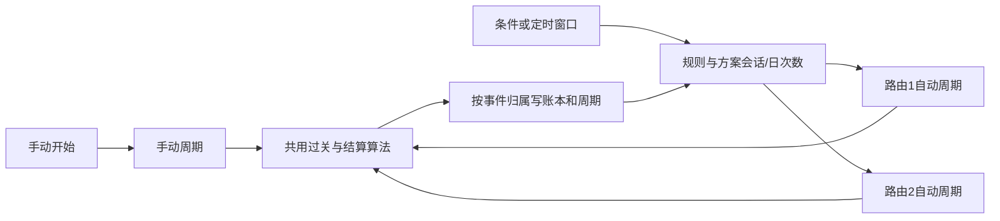

## 摘要

- 保留 Python WSGI、SQLite、原生 JS 表单和现有结算算法；本次增加的是运行归属与调度层，不改变赔率、已有盈亏账本或消息协议。
- 手动周期仅属于跟单方案；自动周期属于规则、方案、路由。规则与方案组成一次启动会话，多个同结构路由只消耗一次每日启动额度。
- 自动规则新增 `cycle_policy`；新规则默认每日 1 次、结束后等待条件，旧规则保持兼容策略快照。每轮参数固定，保存配置不解封当天、不修改在途计划。
- 真实派单与启动额度在同一事务内提交；没有新任务则不耗额度、不留下运行中空壳。跨日中的旧轮继续使用启动日，不被每日重置中断。
- 手动重置不再解封自动规则。新增规则内“恢复本方案待命”入口，仅恢复指定归属且仍受次数、风控和在途限制。

# 手动与自动过关周期隔离架构

功能：`cycle-isolation`；基线：`5b37efa`；工作树：`/tmp/pc28-cycle-isolation`；部署前必须通过迁移与回归验证。

## 1. 现状调研与选型

### 1.1 可验证事实

| 事实 | 代码证据与影响 |
|---|---|
| 手动与自动都读取唯一的订阅周期 | `db_repository.py:get_subscription_cycle_state`、`dispatch_service.py:_dispatch_win_streak_roll_legs` 仅按 `subscription_id` 寻址；一方 pending/day_closed 会挡住另一方。 |
| 多路由第二条被第一条 pending 阻挡 | `_dispatch_signal_for_auto_trigger_routes` 每条路由调用同一周期入口；每个实际投递账户须独立结算。 |
| 自动无路由仍走订阅直派 | `_resolve_auto_trigger_context` 从手动 runtime 追溯规则；`create_progression_event_record` 在 route_id 为空时进入订阅财务与 runtime。只分周期表不能完整隔离。 |
| 停止和重开有跨归属副作用 | `platform_service.reset_win_streak_roll_cycle_for_restart` 会恢复该订阅的自动规则日；须删除此隐式关联。 |
| 日规则轮已有身份约束 | `auto_trigger_rule_runs` 唯一 `(rule_id,subscription_id,stat_date,window_id)`；同日新过关轮不能复用有历史的 run。 |
| 发送有既有防双注规则 | 同信号、同方案、同目标、同 leg 唯一；状态隔离不取消此限制。当前手动过关分支早于 route 占位检查，需移动检查。 |
| 测试与部署 | Python unittest；CI 仅 Docker 构建推送，没有现成前端测试依赖；schema 迁移在 `initialize_database` 内。 |

### 1.2 候选方案比较

| 方案 | 优点 | 代价／风险 | 结论 |
|---|---|---|---|
| 改现有 `subscription_cycle_states` 为所有归属复合主键 | 一个 CRUD 模型 | 需重建现表并修改所有旧调用；旧归属缺字段，迁移与回滚面较大 | 不选 |
| 保留手动表，新增自动周期与会话控制表 | 老手动 API 保留；自动归属显式；可加性迁移与保留原始迁移证据 | 多出自动 CRUD 和联合 pending 枚举 | 采用 |
| 为每条规则复制跟单方案 | 可暂时绕开共享状态 | 用户会看到重复方案、报告身份混乱，无法解决原方案的手动与自动共存 | 不选 |

自动无路由的两种做法：新增整套无路由自动财务表需要侵入盈亏报表；使用内部继承路由可以复用现有自动财务/续派链。采用后者，明确隐藏标记与更新隔离，不改用户可见投递选择。代码调研已足以完成此局部选型，不增加框架、中间件或部署依赖。

## 2. 边界与职责

### 2.1 配置归属

跟单方案保留结构 A/B/C/D/follow_signal、base_amount、main_share、roll_mode、target_streak、结算配置和手动 stop_policy。自动规则启动时继承这些下注参数并生成本轮快照；后续修改只影响下一轮。

规则 `cycle_policy.mode=rule` 时，由自动调度处理轮结束、每日次数与再次启动；手动 stop_policy 对该规则不起作用。普通 fixed/martingale/follow_source 仍走现有路径，不受该新策略改变。

### 2.2 状态归属

- 手动：`manual(subscription_id)`，继续使用手动周期表。
- 自动派单与余额：`auto(rule_id, subscription_id, route_id)`。
- 自动一次启动/日额度：`session(rule_id, subscription_id)`，相同启动扇出的多个路由共享一次额度。
- 历史盈亏归属不迁移、不重算；仍依 progression_event 的 rule/route/run 归属结算与汇总。
- 同群去重保持现有规则：两个归属选择同一信号、同一方案、同一目标时只能一个占位成功；另一方等待，不能消费额度或把别人的 leg 引入自己的 pending。



## 3. 数据与内部契约

新增 DDL、向前兼容字段与迁移由 repository owner 独占。表名与公开方法如下；实现可将内部 SQL 拆为辅助函数，但不得改变外部语义。

### 3.1 配置

`auto_trigger_rules.cycle_policy_json TEXT NOT NULL DEFAULT '{}'`。

```json
{
  "mode": "rule",
  "max_starts_per_day": 1,
  "on_target": "wait_condition",
  "on_bust": "wait_condition"
}
```

- mode：`rule` 或 `legacy`；创建只能为 rule，缺省如示例；读取旧 `{}` 为 legacy，更新旧规则未提供该字段保持原值。
- max_starts_per_day：严格整数 `1..1000`，不接受布尔、小数、无限或 NaN。
- on_target/on_bust：`wait_condition | new_cycle | close_day`。
- legacy 仅供已有规则兼容，不能新建或从 rule 切回 legacy。
- 既有 legacy 首次迁移时按关联方案保存原 stop_policy 快照（见 session），之后手动设置变化不改变该自动规则的旧生命周期。尚未关联的 all_subscriptions 新方案在首次自动使用时冻结一次。
- rule 配置保存不改变活跃周期的下注或生命周期快照，不清次数、不解封 stopped。

### 3.2 自动周期表 `auto_trigger_cycle_states`

复用手动表中的 state/policy/pending 列，增加显式归属：

| 字段 | 类型／约束 |
|---|---|
| rule_id, subscription_id, route_id | INTEGER，复合主键；route_id=0 仅用于迁移中的旧无路由归属，不允许新轮使用 |
| user_id | INTEGER，同规则、方案、路由 owner 一致 |
| rule_run_id | INTEGER，可空，仅迁移时空；本轮已认领后必填 |
| stat_date | TEXT，本轮启动交易日，北京时间 |
| balance, cycle_stake, day_pnl, win_streak, target_streak, status, stop_reason, periods | 沿用现有周期语义 |
| pending_plan_json, policy_json | TEXT，快照；pending 包含 owner、rule_run_id、issue、leg_event_ids |
| cycles_today, day_closed, day_close_scope, last_cycle_stop_reason, updated_at | 沿用基础状态类型；自动 mode=rule 的每日新开次数以 session/day 表为准 |

route=0 的旧自动周期保留原资金、关数、事件归属及旧无路由结算路径，继续整个原轮直至自然达标或爆仓；不能在单期 pending 结算完成后截断原轮，也不能把历史 leg 改成内部路由。原轮终结前，该 rule+subscription 不得创建新轮，手动重置／开始新一轮也须阻止，包括两期间没有 pending 的空隙。原轮终结后，下一次自动启动才使用内部继承路由，手动运行才可独立开始。

### 3.3 自动会话 `auto_trigger_cycle_sessions`

主键 `(rule_id,subscription_id)`；列：`user_id`、`status`、`active_run_id`、`start_stat_date`、`last_start_issue`、`last_completed_issue`、`stop_reason`、`policy_json`（本轮生命周期快照）、`legacy_policy_json`（首次冻结的旧生命周期）、`participating_route_ids_json`、`updated_at`。

status 枚举：`waiting`、`running`、`continuation`、`day_closed`、`blocked`。

- waiting：下一新开奖/新鲜信号上的条件可再判。
- continuation：结束配置为 new_cycle，等待下一可投注信号，不要求触发条件。
- day_closed：本交易日收工；下一交易日进入 waiting。保存配置不解封。
- blocked：归属无法确认、人工停轮或迁移需检查；不会自动跨日解封不明归属。

### 3.4 每日启动 `auto_trigger_cycle_daily_starts`

主键 `(rule_id,subscription_id,stat_date)`；列 `user_id, starts_count, last_start_issue, updated_at`。只记录成功开轮数；清空盈亏、修改阈值、恢复待命均不能减少它。旧自动轮迁移按已有 run / old cycles_today 证据初始化，不重复累计。

### 3.5 内部继承路由

`auto_trigger_rule_routes` 加 `is_implicit INTEGER NOT NULL DEFAULT 0`。

- 无显式路由的自动过关方案在启动事务内，从方案 `dispatch.delivery_target_ids` 解析目标，未指定则取该用户当前有效默认目标。
- 校验 owner、target/account/source/subscription status、dispatch_mode（规则不得投 direct_only）。
- 按 `(rule_id,delivery_target_id,is_implicit=1)` 幂等建立 route，参数固定继承方案/规则，无新 UI 功能。
- 真实查询与续派可取 implicit route；用户列表 `rule.routes` 与保存 route 同步只操作 `is_implicit=0`。用户保存空 routes 不得删除内部路由；切换显式路由也不取消已有内部在途，下一轮按新设置选择。
- 全部方案范围：每个方案独立解析自己的有效目标，不把另一个方案的目标带入。
- 内部 route 可复用既有自动账本，其身份不含 subscription，因为已有 route runtime/财务本身按 route+subscription 区分。

### 3.6 迁移证据 `cycle_state_migrations`

按 subscription_id 唯一保存原始 state JSON、识别 owner JSON、迁移状态/原因/时间，重复初始化不重复迁移。

1. 原表 pending_plan 的 rule/route/run 归属与 leg_event_ids 一致：迁移为对应自动周期；无规则且 leg 均手动则留手动。
2. 已清 pending 的周期，按最近同一周期的 progression_event.result_context.cycle、rule_run、时序共同确认归属。只有唯一可信 owner 才迁移。
3. 找不到历史或 periods=0 的未使用基线可保留手动基线，自动需要时独立初始化。
4. 存量自动已收工：迁移其 balance/day_closed/stop_reason 和规则日 stopped 原样保留，不能因分表重开。
5. 证据冲突、同时归属多个 owner 或在途归属不完整：原数据归档，并将相关 owner 标记 blocked；提供可读原因。禁止猜测复制成多个可运行账户。
6. 确认自动的原手动表状态移出后，不把自动余额/待结算复制成新的手动基线。手动随后由明确手动启动建立初始状态。
7. 不更改既有 progression_events、execution_jobs、financial_state、report_daily_stats 金额和已结算归属。旧无route自动轮沿原路径续投与结算到自然达标／爆仓，期间保持原关数和资金，并阻止手动重置；单期结算完成不代表迁移排空完成。禁止以迁移为由回放派单或额外开轮。

### 3.7 Repository 方法签名

所有写方法复用 `repository.transaction()` 的 `BEGIN IMMEDIATE`，不得内部提交外层事务；owner 参数必须核对。

```python
get_auto_trigger_cycle_state(*, rule_id: int, subscription_id: int,
    route_id: int, user_id: int) -> dict | None
upsert_auto_trigger_cycle_state(*, rule_id: int, subscription_id: int,
    route_id: int, user_id: int, rule_run_id: int | None,
    state: dict, policy: dict | None = None, pending_plan: dict | None = None) -> dict
list_pending_win_streak_cycles(user_id: int | None = None) -> list[dict]
# 联合manual+auto，返回显式scope、rule/route/run，不允许结算调用者猜归属。
get_auto_trigger_cycle_session(*, rule_id: int, subscription_id: int, user_id: int) -> dict | None
upsert_auto_trigger_cycle_session(*, rule_id: int, subscription_id: int,
    user_id: int, values: dict) -> dict
get_auto_trigger_cycle_daily_starts(*, rule_id: int, subscription_id: int,
    user_id: int, stat_date: str) -> dict
claim_auto_trigger_cycle_start(*, rule_id: int, subscription_id: int,
    user_id: int, stat_date: str, started_issue_no: str,
    max_starts_per_day: int, policy: dict, route_ids: list[int],
    window_id: str = '') -> dict
# {claimed: bool, reason: str, run: dict, starts_count: int}
# 在已有外层启动事务中调用：新run唯一window key为roll:<ordinal>[:<schedule_window>]。
# claim将session设running并计数；若派单为0，外层必须整体ROLLBACK，不允许单独留下额度。
complete_auto_trigger_cycle_session(*, rule_id: int, subscription_id: int,
    user_id: int, rule_run_id: int, completed_issue_no: str,
    status: str, stop_reason: str = '') -> dict
# 所有参与route均完成才结束session；仍有pending不接受正常结束。
ensure_implicit_auto_trigger_route(*, rule_id: int, user_id: int,
    delivery_target_id: int) -> dict
list_auto_trigger_cycle_runtime(*, rule_id: int, user_id: int,
    stat_date: str) -> list[dict]
ensure_auto_trigger_cycle_route_runtime(*, rule_id: int, subscription_id: int,
    route_id: int, user_id: int, rule_run_id: int, strategy: dict,
    started_issue_no: str, signal_id: int | None = None) -> dict
# 为已认领会话建立续派入口，支持dispatch_latest_signal=false，不再消耗日额度。
discard_unstarted_auto_trigger_cycle_routes(*, rule_id: int, subscription_id: int,
    user_id: int, rule_run_id: int, route_ids: list[int]) -> dict
# 部分路由起投成功时移除未实际起投的参与入口，不影响历史资金或已派任务。
resume_auto_trigger_cycle_day_scope(*, rule_id: int, user_id: int,
    subscription_id: int, stat_date: str) -> dict
# 将旧cycle_*整规则/路由收工转为方案归属，仅恢复所选方案；不解日风控、不清次数或账本。
```

会话完成要关闭该 run 的 route runtime 并保留其已结算统计；原 `reset_auto_trigger_route_subscription_runtime(force=True)` 会产生人工停止标签，不应拿来冒充正常轮终结。新增辅助 SQL 只关闭指定 rule_run 的运行态，不清历史钱。

## 4. 流程与状态机

### 4.1 开新轮

1. 识别方案是否过关，非过关走旧路径。读取规则归属的 session；跨日运行中的旧 session 仍算 active，不新开。迁移中的 legacy route=0 继续原轮到自然达标／爆仓，不因一期结清改走内部路由。
2. waiting 走原条件/定时窗口判定；continuation 可跳过条件，但仍要求下一未投注信号及当前规则、来源、方案、目标有效。
3. waiting 的证据期必须 `latest_settled_issue > last_completed_issue`，不能用完成那一期重新触发。首次启动仍使用现有条件含义。
4. 原 `cooldown_issues` 从上次启动期算，仅约束 waiting 的条件重触发；new_cycle 不等条件/冷却，但必须下一可投注期。定时触发仍需有效窗口与星期限制；窗口内可多次开过关轮，受每日额度约束。非过关定时窗口原语义不变。
5. 用 fresh signal 做封盘预判；无信号或不可投仍 waiting/continuation，不切 manual active。
6. 开事务：重读所有状态、日风控、owner 与当前配置，检查无 pending/active session、quota、同一期已消费与目标占位。解析内部路由或显式路由，建立本轮快照，claim 一次规则方案启动。
7. 每个实际参与 route 建自己的 cycle，使用同一继承结构。派单生成双 leg；任何复用旧 job/event 都不能当成本轮成功。全部零创建则回滚整个 claim；成功路径至少一条 route 两腿已新建，已参与集合只能包含真正起轮的 route。
8. 多目标有部分不可用时，其余目标按现有路由规则可启动；在触发事件中列清 skipped_routes，不把未启动 route 当作已参与并永久等待。无故 second-route pending 阻挡必须消除。
9. `dispatch_latest_signal=false` 的旧“仅开轮”语义保留，可成功认领一次；后续首个新信号继续该 session，不再扣次数。

### 4.2 每期结算

结算按 pending owner 找回状态，只有本期两腿终态才推进。dispatch/settlement 对同一owner采用事务与pending issue/run比较，重复回执或重复settlement不得推进两次、清掉新pending。

手动仍用原 stop_policy。自动 mode=rule 使用本轮 policy 快照，仅运行“一轮连赢/资金耗尽”算法；不在纯算法内部补仓或直接改 running。自动调度收到达标/爆仓结果后才决定下步：

| 配置 | 行为 |
|---|---|
| wait_condition | 本route轮结束；所有参与route完成后关闭本run，session waiting，记录完成期号 |
| new_cycle | 本route轮结束；所有参与route完成后关闭本run，session continuation，下一可投注信号认领新轮，从base_amount起注 |
| close_day | 仅停当前 rule+subscription 当天会话，剩余已发送单正常结算，后续不派新期；不得停止本规则其他方案 |
| 今日额度已满 | 当前轮仍正常完成；完成后 day_closed，不截断已经开始的一轮 |
| 规则日风控、停用或人工停轮 | 优先于任何续开策略；不自动恢复，不重新补仓 |

多个route结局不同：全部终结是进入下一轮的屏障；只要任一路由要求 close_day，就停止该会话当天；否则若全部要求 new_cycle 则 continuation；其他情况 waiting。这里不提供路由独立结构配置。

legacy 使用首次冻结的手动 stop_policy 的旧语义（包括continue保持原链和new_cycle），但状态、财务、重置已隔离。legacy结束行为不能从用户之后的手动设置动态读取。

### 4.3 跨日

正在运行的自动周期不调用 `ensure_daily_state(today)` 重置中途进度；始终传本轮 start_stat_date。旧轮在新一天结算完，额度仍记启动日，完成后可按新一天计数再触发。日盈亏继续按既有北京时间结算日账本计算，不随启动日重写。日风控派单前同时检查当前日与旧run已被停止状态，避免通过旧日期绕过新日限额。

### 4.4 恢复与修改

独立 mode 的 `close_day` / 每日次数用尽只关闭 rule+subscription 会话，不调用 `stop_auto_trigger_rule_day_for_cycle` 全规则闸。只有既有规则级日止盈止损才停止整规则；legacy 仍保留原 close_scope 语义。

- 手动 restart/reset 只访问manual周期与manual runtime，不调用恢复规则日/释放规则窗口的旧辅助函数。若同方案有尚未自然终结的 legacy route=0 自动轮，则拒绝手动重置／新开，即便当前没有 pending，以免清除原轮仍需使用的旧账本。
- 自动恢复入口指定 rule+subscription，只恢复等待，不派单、不清次数、不清盈亏。
- 若日次数已满，需用户先显式提高规则额度；恢复入口本身不能突破上限。若日风险仍触发或有在途/运行中，拒绝恢复。
- 恢复不影响其他规则和manual；使用新规则run ID，不能复用有结算历史的旧run。
- 调整目标结构、金额、收工策略只影响下一轮；当前pending与会话快照保持。
- 既有 update-rule 的自动恢复辅助逻辑、`/resume-day` 与启停规则入口均不能绕过该会话收工或quota限制；显式 `/resume-cycle` 才能按上述条件恢复指定会话。

## 5. 对外 API 契约

沿用 Cookie 认证和现有响应形状，不新引统一 envelope。

| 方法 | 路径 | 请求／响应 | 认证 |
|---|---|---|---|
| POST | `/api/platform/auto-trigger-rules` | 原字段加可选cycle_policy；200 `{item: rule}` | Cookie，当前用户 |
| POST | `/api/platform/auto-trigger-rules/{id}` | 部分更新cycle_policy；200 `{item: rule, ...原字段}` | 同owner |
| GET | `/api/platform/auto-trigger-rules?stat_date=YYYY-MM-DD` | 200 `{items: rule[]}`；rule新增cycle_policy、cycle_runtime | 同owner |
| POST | `/api/platform/auto-trigger-rules/{id}/resume-cycle` | `{subscription_id:int}`；200 `{resumed:bool,item:rule,cycle_runtime:object}` | rule与sub同owner且仍在作用范围 |
| GET | `/api/platform/subscriptions/summary` | 原items每项增加manual_cycle_state或null | 同owner |
| POST | 既有订阅restart/reset端点 | 兼容原请求／响应，副作用限manual | 同owner |

`cycle_runtime` 的数组项：

```json
{
  "subscription_id": 18,
  "subscription_name": "过三关",
  "outside_scope": false,
  "stat_date": "2026-11-05",
  "starts_today": 1,
  "max_starts_per_day": 3,
  "status": "waiting",
  "active_run_id": null,
  "start_stat_date": "2026-11-05",
  "last_completed_issue": "3502506",
  "stop_reason": "cycle_balance_depleted",
  "routes": [{"route_id":11,"route_name":"测试群","status":"stopped","balance":2.35,"cycle_stake":0,"win_streak":0,"target_streak":3,"pending_issue":""}]
}
```

`stat_date` 对应用户所选计数日；`start_stat_date` 是当前或最近一轮的启动日。`outside_scope` 为布尔值，标记方案已移出该规则当前作用范围；既有运行记录仍保留展示，界面提示“已移出规则范围，仅保留运行记录”，不得据此恢复或新开。内部路由的名称可回显目标名称，但不能变成可编辑route表单行。

`manual_cycle_state`：`{stat_date,status,balance,cycle_stake,day_pnl,win_streak,target_streak,periods,cycles_today,day_closed,stop_reason,pending_issue}`；仅手动状态，未开始可null。

错误保持 `{error: 中文说明}`：非法字段/范围/在途/次数满/规则停用/风险未解除均400；未登录401；其他用户资源不泄露，沿用现有不可见资源错误约定。服务端是唯一校验来源，前端禁用仅做提示。

## 6. 代码划分与写集建议

- repository owner：`executor/db_repository.py` 全部DDL、migration、owner CRUD、atomic claim、internal routes、runtime查询、同目标占位/账本归属、repository测试。
- orchestration owner：`domain/auto_trigger_cycle.py`（新增政策/状态转换纯逻辑）；`services/auto_trigger_service.py`、`dispatch_service.py`、`pc28_auto_settlement_service.py`、`platform_service.py`、`api/app.py`；必要的`domain/win_streak_roll.py`最小接口；跨层业务测试。
- frontend owner：`ui/auto_triggers.html/js/css`、`ui/autobet.html/js`；仅使用以上契约，保持现有视觉风格。
- QA：新增迁移/跨日/并发/真实API+UI提交测试，禁止对线上运行run-once、发送消息、重置真实账户。
- 不增加运行依赖，不改CI/部署配置；部署先备份SQLite，暂停全部访问repository的worker，统一升级后恢复，避免新旧代码混写。

## 7. PRD追溯、验收与风险

PRD FR-001/002 对应§2、§3.2、§4.4；FR-003/004对应§3.1与§5；FR-005/006/007/008对应§4.1/4.2及日计数；FR-009/010对应事务/同目标去重及归属恢复；FR-011对应§4.3；FR-012对应§3.6；FR-013对应§5 runtime/manual 状态回显。

| 验收 | 必须验证 |
|---|---|
| 手动/自动并存 | 手动余额/计数/停止不影响rule A；rule A不影响rule B；相同目标冲突不重复发送、不耗另一方额度 |
| 一天多次等待条件 | 连大双启动→结束→同一期不重开→新一期再次达条件→第2轮；上限后不再开 |
| 直接续开 | 下一可投注信号新run、count+1、base_amount起步；inactive/日风控/在途禁止 |
| 多路由 | 两route都派双腿；各自结算；会话日额度只+1；最慢route未结束前不新起 |
| 零派单 | 没信号、已开奖、目标被占、已禁用均不认领；重试成功只+1 |
| 跨日 | 23:59旧轮到次日继续进度；完成不消耗新日quota；日盈亏仍归实际结算日 |
| 迁移 | manual、auto pending、auto已收工、旧无route在途、混合不明归属，重复initialize均幂等；钱与历史归属不变 |
| 重置 | 手动restart不解封auto；规则恢复只影响指定sub，拒绝quota满与pending |
| 表单/API | 新建默认rule；legacy旧规则保存保留；严整数；未授权不能修改；保存不解封 |

高风险项是存量归属与实际下注次数。未通过迁移快照对账或同目标冲突红测，不允许部署。baseline全套582项中两条既有手动restart解封自动测试失败/依赖北京日期，须改为新的隔离预期并固定日期；其余580项作为回归基线。

部署策略：本工作树仅实现与验证，不触碰线上数据或自动发送。待完整测试和独立review通过后给出确切迁移结果与发布步骤。备份回滚只能整体代码+数据库版本配对，不允许运行新DDL后直接混用旧worker。
