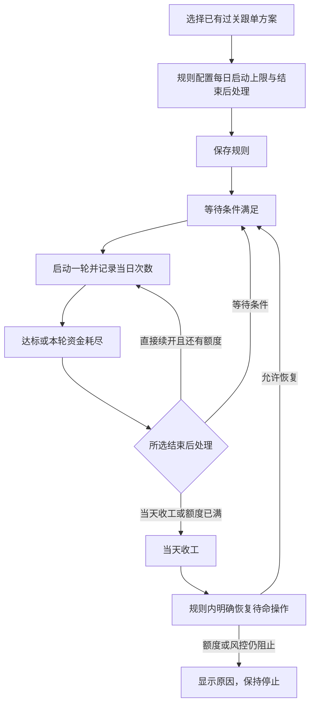

## 摘要

- 沿用自动触发规则与跟单方案现有表单、卡片、按钮及颜色，不新增导航页或组件库。
- 自动规则新增“过关轮次管理”：每个方案每日启动上限、过关成功后及本轮资金耗尽后的处理；只影响过关方案，普通均注/倍投保持原行为。
- 新规则默认“由本规则控制、每天 1 轮、结束后等待条件”；旧规则显示“沿用原有结束设置”，显式切换才使用规则配置，保存不会解除已收工状态。
- 自动规则详情展示本规则各方案的次数和各投递的过关进度；手动方案只展示手动状态，两处操作明确各自作用范围。
- 恢复待命不立即派单，不清空日次数或历史盈亏；当前有待结算任务、日额度用完或风控仍阻止时给出具体原因。

# 手动与自动过关隔离 UI 规范

## 1. 设计概述

功能名称：cycle-isolation。目标是让用户能明确区分“这条自动规则今天还可以启动几轮”和“手动跟单的过关状态”。本次扩展现有 `/auto-triggers`、`/autobet/subscriptions`；不做不同路由独立结构设置、不更换页面风格、不增加图表或复杂动效。

单轮投注参数仍在跟单方案维护，自动规则负责该规则启动的轮次生命周期。页面不向用户展示数据库主键、scope key 或迁移表名。

## 2. 用户流程



“等待条件”要求使用本轮结束之后的新一期判断，不复用刚结束那轮之前的开奖证据；“直接续开”仍等待下一可投注信号，受规则启用状态、每日额度和日风控约束。

## 3. 设计令牌

本次所有新增组件使用下列语义别名，别名绑定现有页面样式；无需为全站重建 tokens。令牌定义是唯一允许出现样式值的位置，其余章节引用名称。

| 令牌 | 绑定或定义 | 用途 |
|---|---|---|
| color.page | 现有 `--bg` | 页面背景 |
| color.surface | 现有 `--surface`；手动页卡片沿用现有实色面板 | 卡片背景 |
| color.subtle | 自动页 `--surface-subtle` | 设置区浅背景 |
| color.text | 现有 `--text` | 标题与正文 |
| color.muted | 现有 `--muted` | 辅助说明 |
| color.border | 现有 `--line` | 分组与输入框边框 |
| color.action | 自动页 `--accent`；手动页 `--primary` | 操作与焦点 |
| color.actionStrong | 自动页 `--accent-strong`；手动页 `--primary-strong` | 激活操作 |
| color.error | 现有 `--danger` | 错误消息 |
| color.warning | 自动页 `--warning`；手动页状态沿用现有告警样式 | 收工/待核对提示 |
| color.success | 自动页 `--ok`；手动页沿用现有成功状态样式 | 运行或保存成功 |
| type.heading | 现有 `.section-head h3` | 新增分组标题 |
| type.label | 现有 `.field span` | 控件标签 |
| type.body | 继承页面 `font` | 选项与正文 |
| type.note | 现有 `.meta-line` / `.field-hint` | 说明与状态 |
| type.numeric | 现有 `.mono` | 期号、次数和金额 |
| space.label | 现有 `.field` 的 gap | 标签到控件 |
| space.form | 现有 `.form-grid` 的 gap | 表单间距 |
| space.section | 现有 `.condition-panel` 的 padding / margin | 设置区内外距 |
| space.card | 现有 `.rule-card` 的 padding | 状态块内距 |
| radius.control | 现有 `.text-input` | 控件圆角 |
| radius.panel | 现有 `.condition-panel` | 设置区圆角 |
| shadow.panel | 现有 `.rule-card`（无新增阴影） | 保持现有层级 |
| target.touch | `44px` 最小可点击区域 | 移动端操作目标 |
| breakpoint.ruleTablet | `1080px` | 自动页改单栏布局 |
| breakpoint.ruleMobile | `720px` | 自动页控件单列 |
| breakpoint.manualTablet | `1180px` | 手动页沿用现有布局断点 |
| breakpoint.manualMobile | `900px` | 手动页详情与表单单列 |

状态必须同时有文字，不能仅依赖颜色。新增文字的实测对比度至少 4.5:1；现有样式不满足时仅对新增块采用 color.text，不以低透明度表达说明。沿用现有亮色模式，本次不新增主题切换。内容显示/隐藏即时完成，避免轮次状态跳动动画；不添加装饰阴影或渐变。

## 4. 自动规则编辑区

### 4.1 位置与作用范围

在跟单方案选择区域之后、开始条件之前增加“过关轮次管理”分组。组头固定说明：

> 这里只管理本规则启动的过关轮次。投注结构、起始金额和过几关继承跟单方案；普通均注、倍投不受本区设置影响。

即使选择“全部跟单方案”，此说明也保留。当前选择范围没有过关方案时，显示“当前范围没有过关方案；这些设置将在选用过关方案时生效”，允许保存规则，不能误将普通方案计入过关额度。

### 4.2 表单契约

`cycle_policy` 由规则创建/更新 API 收发。字段值与文案如下：

| 表单标签 | payload 字段 | 取值与显示 | 初始值 / 校验 |
|---|---|---|---|
| 轮次管理方式 | `cycle_policy.mode` | `rule`：由本规则控制；`legacy`：沿用原有结束设置 | 新建固定 `rule`；仅返回 legacy 的旧规则显示兼容选项 |
| 每个方案每天最多启动 | `cycle_policy.max_starts_per_day` | 正整数，单位“轮” | 新建 1；范围 1–1000，拒绝空白、小数、NaN、越界 |
| 过关成功后 | `cycle_policy.on_target` | 见处理选项表 | 新建 `wait_condition` |
| 本轮资金耗尽后 | `cycle_policy.on_bust` | 见处理选项表 | 新建 `wait_condition` |

| 枚举 | 下拉选项 | 选中后说明 |
|---|---|---|
| `wait_condition` | 等待下次条件满足 | 本轮结束后回到待命，使用结束后的新一期重新判断条件；仍受冷却期数限制。定时规则显示“等待新一期且处于允许的定时窗口”，同一窗口内允许在上轮结束后再次启动。 |
| `new_cycle` | 下一可投注期直接续开 | 不重新等待开始条件，按方案起始金额开启下一轮；仍计入每日上限并受日风控限制。 |
| `close_day` | 当天收工 | 本轮结束后停止本规则该方案当日的过关启动。 |

额度说明固定为：

> 按北京时间的启动日期计数，首次启动也计 1 轮；跨日继续运行的旧轮不占今天的新开额度。两个投递使用同一轮时只计一次。

上限为 1 且任一处理选择等待/续开时，在处理说明后补充“当前每天最多 1 轮，本轮结束后仍会因额度用完收工”。不要强制改掉用户的处理选择，避免之后调大上限时丢失配置。

现有冷却控件增加说明：

> 冷却限制再次按条件触发的间隔，不影响本轮继续投注；选择直接续开时不重新等待条件。

### 4.3 旧规则兼容与编辑

- `mode=legacy` 显示紧凑状态条：“沿用原有结束设置。切换为由本规则控制后，新的轮次将使用本区设置。”
- legacy 状态下隐藏或禁用独立上限/结束处理控件，并展示从服务端读取的原有模式摘要；不能提交未展示的默认值覆盖旧设置。
- 新建规则不提供 legacy 入口。已经独立控制的规则不允许通过 UI 回切 legacy。
- 旧规则显式切换 rule 时，预填 1 / wait_condition / wait_condition，显示这组实际值供用户编辑。切换不调用恢复、启动或重置 API。
- 保存后只按服务端成功结果回显；失败保留输入。修改名称、条件、路由或配置不能清空日计数、解封当天收工或重置待结算周期。
- 在跑轮次沿用开轮快照，新设置用于下一轮；保留一句“正在运行的轮次按开轮时设置完成”。

## 5. 自动规则运行详情

规则卡片保留现有条件、盈亏、状态、编辑与检查入口，新增可折叠“过关运行”区域。不把摘要数字或状态整行做成操作按钮。

### 5.1 数据契约与呈现

规则列表项增加 `cycle_runtime[]`，每项代表本规则下一个过关方案：

```json
{
  "subscription_id": 18,
  "subscription_name": "jnd28波动反弹模型 过三关",
  "stat_date": "2026-11-05",
  "starts_today": 1,
  "max_starts_per_day": 3,
  "status": "waiting",
  "active_run_id": null,
  "start_stat_date": "2026-11-05",
  "last_completed_issue": "3502506",
  "stop_reason": "",
  "routes": [{
    "route_id": 11,
    "route_name": "测试群",
    "status": "waiting",
    "balance": 2.35,
    "cycle_stake": 0,
    "win_streak": 0,
    "target_streak": 3,
    "pending_issue": ""
  }]
}
```

每方案按以下顺序展示：方案名称、语义状态、`所选日已启动 1 / 3 轮`、当前轮次启动日（存在时）、各投递余额/本期滚仓注额/连续盈利关数/待结算期号。数字零正常显示，缺值显示“—”，不能将未知状态显示成已停止或可启动。

不配置路由时，投递行标题为“继承方案投递”，不用暴露 route_id=0。多个路由可以展开查看状态，均继承方案同一结构；本次不出现路由结构下拉。

`stat_date` 与页面所选统计日期一致；`start_stat_date` 是实际运行轮次启动日。跨日时显示“上一日启动，当前仍在运行”，删除旧文案“会占用今天的开轮额度”。不把 `starts_today` 与历史余额强行合并成当日账本。

### 5.2 状态文案

| status | 显示 | 补充说明 |
|---|---|---|
| `waiting` | 等待触发 | 条件/定时窗口满足、冷却结束且仍有额度时开启下一轮。 |
| `running` | 进行中 | 有 `pending_issue` 时显示“第 X 期待结算”；无待结算时显示“等待下一期信号”。 |
| `continuation` | 等待直接续开 | 本轮结束，等待下一可投注信号；不重新等待条件。 |
| `day_closed` | 当天收工 | 本方案的行显示“本方案今日收工”，根据 `stop_reason` 说明达标、资金耗尽或今日次数已满；规则日风控在规则卡片另显示“规则日风控停止”，不把单方案收工说成整条规则停用。 |
| `blocked` | 暂停，需核对 | 归属/历史状态无法确认时显示“历史过关状态需核对，自动续投已暂停”，不提供忽略按钮。 |

规则本身停用/归档、来源停用等现有状态继续展示，并且优先限制动作。状态文字不使用原始英文原因码。未知原因码用“当前暂不可启动”，在事件详情中保留服务端错误文案。

### 5.3 操作与范围

- **检查**：沿用现有 run-once。只调用现有评估流程，不绕过额度、冷却、已有轮次或日风控。
- **结束当前轮次**：作用域在文案中写明“本规则”。有待结算单时说明“已发送单仍会结算”；不能承诺立刻开始下一轮。条件规则与定时规则的成功文案分别对应等待新条件、等待新一期且处于允许窗口，不能一律显示“下一个时间窗口”。
- **恢复本方案待命**：位于每个方案详情的独立操作区，调用 `POST /api/platform/auto-trigger-rules/{id}/resume-cycle`，body 为 `{subscription_id: 整数}`。按钮 accessible name 包含规则及方案名称，视觉文案保持简短。
- 恢复成功：`{resumed:true,item:rule,cycle_runtime:object}`，重新读取规则列表；提示“已恢复本规则下该方案的待命状态，仍需满足触发条件。日次数和历史盈亏已保留”。不调用 run-once，不立即派单。
- 若已运行、有待结算单、今日额度已满、风险仍触发、规则未启用，操作禁用并显示原因；服务端返回 `{error:string}` 时在状态区域完整显示并保留原状态。服务端必须再次校验，不能仅依赖前端禁用。
- 恢复不返还已用次数。额度用完时可编辑提高上限，但保存本身不会解封，仍由明确恢复操作执行。
- 查看历史日期时，运行操作仅作用当前日期；为避免误解，“恢复本方案待命”在历史日期视图隐藏，保留“切回今天操作”的普通链接。
- 原有“继续今日触发”是规则日风控恢复入口；保留其原职责，不能借此清除单方案次数。过关状态的恢复使用新的 scoped 操作。

## 6. 手动方案页面

### 6.1 配置归属

投注结构、起始金额、滚仓方式与过关目标维持原字段与交互。“达标后/爆仓后/一天最多几轮”组标题改为“手动过关结束设置”，说明“以下设置管理手动启动的轮次。自动规则的轮数与结束处理在规则中设置”。兼容旧自动规则显示的原有设置由旧规则摘要说明，不在此宣称编辑会重置自动状态。

- “过几关收工”调整为“每轮过几关”，防止与自动规则的当天收工动作混淆。
- “每天起始注”说明当前为每轮起始注，同时保留服务端原字段 `base_amount`。
- `roll_close_scope` 不再向手动用户显示“整条规则/只停路由”的误导选项；已有字段可在兼容序列化中保留，但独立手动行为只作用手动运行。
- “开始新一轮”按钮改为“手动开始新一轮”，确认/成功消息只提手动周期，不再声称恢复自动规则或释放定时窗口。
- “重置盈亏”明确为手动盈亏基线操作，自动账本和日计数不会被该操作清空。

### 6.2 手动运行展示

手动卡片显示“手动过关状态”，至少包含余额、当前关数、当天轮数、待结算期号和停止原因。只使用服务端提供的手动周期数据；自动规则正在投注但手动从未启动时，手动显示“尚未手动开始”，并提供普通导航链接“查看自动规则”。不读取自动 cycle_runtime 回填手动卡片。

列表及详情使用 `subscription.manual_cycle_state`（可为 null）：

```json
{
  "stat_date": "2026-11-05", "status": "running", "balance": 10.0,
  "cycle_stake": 10.0, "day_pnl": 0.0, "win_streak": 0,
  "target_streak": 3, "periods": 0, "cycles_today": 0,
  "day_closed": false, "stop_reason": null, "pending_issue": ""
}
```

`cycles_today` 沿用手动引擎计数口径，展示文案为“当天已重开 X 次”，不能直接当作自动的 `starts_today`。`manual_cycle_state=null` 显示“尚未手动开始”。UI 不从财务汇总或最近自动事件推断手动过关状态。手动继续滚的旧行为保留；自动规则只支持等待条件、下一期另开新轮、当天收工三种动作，不提供不计次数的原地继续滚旁路。

## 7. 组件状态、反馈与无障碍

| 组件 | 默认 | 悬停 | 聚焦 | 激活 | 禁用 | 加载 | 错误 | 空 |
|---|---|---|---|---|---|---|---|---|
| 轮次上限输入 | 展示持久化值 | 沿用输入边框 | color.action 可见焦点 | 输入原生行为 | legacy时不提交隐藏值 | 随详情载入禁用保存 | 字段下报“请输入1–1000的整数”，aria-invalid | 空值不默认为1，提交时报错 |
| 处理方式选择器 | 展示当前选项及说明 | 沿用现有控件 | 可键盘选择、焦点可见 | 选后同步说明 | legacy时禁用 | 随详情载入保留位置 | 非法服务端值阻止覆盖保存 | 新建使用显式默认 |
| 管理方式选择器 | 新规则显示固定说明、旧legacy显示选项 | 沿用选择器 | 可键盘操作 | 仅改变草稿不发请求 | 保存中禁用 | 保存文字“保存中…” | 保存失败保留草稿 | 无配置按服务端识别，不能前端猜旧新 |
| 保存按钮 | 现有 primary | color.actionStrong | 可见焦点 | 单次提交 | 请求中不可重复提交 | “保存中…”并aria-busy | 页面status区域aria-live | 不适用 |
| 恢复待命按钮 | 允许恢复时显示次操作 | 沿用secondary/ghost | 键盘可操作且名称含方案 | 单次POST | 具体限制原因可见 | “恢复中…” | 显示服务端error，不改变本地进度 | 无周期时不显示 |
| 运行状态块 | 名称、次数、进度文字 | 非交互不改变指针 | 块本身不抢焦点 | 不适用 | 不适用 | “正在读取过关状态” | “过关状态读取失败”，保留已知值并标旧 | “尚无过关运行记录” |
| 展开详情 | 显示方案数和摘要 | 沿用ghost | 使用原生details/summary或等价键盘语义 | 展开收起、不跳页 | 请求中可保留已加载内容 | 不新增整页遮罩 | 不适用 | 不渲染空折叠按钮 |

新增字段均有 label 和关联说明，保存错误将焦点定位第一个错误字段。成功状态使用现有 `role=status` 区域；错误声明 `aria-live`，不得只toast一闪消失。恢复请求完成后焦点留在该方案操作区，列表重绘不丢到页面顶部。金额与关数用文字，不引入只有颜色的进度条。触控操作至少满足 target.touch。

## 8. 响应式与边界数据

- 桌面（自动页超过 breakpoint.ruleTablet）：沿用左规则列表、右编辑器；新增分组两列，说明跨整行。过关运行卡片逐方案纵向排布。
- 平板（breakpoint.ruleMobile 至 breakpoint.ruleTablet）：页面单栏，表单仍可两列；每个方案的数字摘要自动换行，操作区换行，页面不横向溢出。
- 手机（不超过 breakpoint.ruleMobile）：新增控件和方案状态单列；按钮占足触控宽度、状态说明可换行，期号保留完整，不横向滚动主页面。手动页按现有 breakpoint.manualMobile 单列。
- 长规则/方案/路由名称允许换行，桌面摘要可省略但详情必须完整可读；不得把不同方案截成无法区分的同名。
- 超长列表默认显示方案数量与前3项摘要，展开能看到服务端返回的全部项，明确“展开其余 N 项”；不在客户端静默截断。路由也采用同样规则。
- 零次数展示 `0 / N`；零余额展示 `0.00`；0关展示 `0 / 3`。没有运行对象显示“尚未启动”，不虚构余额。
- 请求失败保留旧数据并标注“状态未更新”，提供现有刷新操作。服务端返回字段缺失显示“过关状态不可用”，不启用恢复按钮。

## 9. 需求追溯与写集

| 元素 / 行为 | PRD |
|---|---|
| 手动卡片只显示 manual_cycle_state、自动rule显示cycle_runtime | FR-001、FR-002、FR-013 |
| 自动每日上限/达标后/资金耗尽后配置 | FR-003、FR-007 |
| 参数继承说明与在跑轮次快照提示 | FR-004 |
| 等待条件文案、直接续开文案、冷却说明 | FR-005、FR-006、FR-008 |
| 手动原有配置与专属重启/重置操作 | FR-009、FR-010 |
| 明确启动日期与统计日期、跨日不占今天额度 | FR-011 |
| legacy兼容模式、存量已收工不被保存解封 | FR-012 |

前端计划写集为 `src/pc28touzhu/ui/auto_triggers.html`、`auto_triggers.js`、`auto_triggers.css`、`autobet.html`、`autobet.js`，必要时仅对新增手动进度块补充 `autobet.css`；不改共享鉴权/菜单或其他页面。前端测试单独文件，由实施计划指定单一owner。

## 10. 验证清单

1. 新建默认rule/1/wait_condition/wait_condition，编辑旧legacy不触发隐式迁移；名称-only保存保留模式。
2. 保存合法上限与两种结束动作，再加载准确回显；非法值在UI及真实API双重拒绝。
3. 当前1/3轮、状态waiting时恢复待命不会派单；3/3轮按钮禁用且API同样拒绝。
4. 手动新一轮只改变手动状态，规则进度/次数/账本保持；规则恢复不改变手动状态。
5. 历史统计日与跨日当前run明确分开；上一日run不显示占用今日额度。
6. 条件规则结束文案不说“下个窗口”；定时独立模式可以在允许窗口内按新一期重新启动，不错误要求等下一个窗口。
7. 多路由只显示同一结构的投递状态；无路由显示“继承方案投递”。
8. 桌面/平板/手机均可键盘或触控完成编辑、保存、展开详情；恢复按钮说明错误与禁用原因。

## 11. 设计资源

- `ui-design.json` 与本文件使用同一字段、状态及操作语义；其frames是现有页面的局部结构图，不要求整页重做。
- 预览入口：`node /root/.agents/skills/boss/cli/bin/boss.mts design preview cycle-isolation`。
