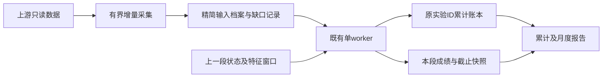

# 增量续跑与历史成绩保留

## 目标与切换时间

用户不接受每月重跑历史，也不接受源库清理导致历史无法复现的循环。2026-11-26决定立即在独立开发分支`feat/rule-lab-incremental-replay`设计和开发；当前五方案比较组继续用线上旧版跑完。生产切换条件是该组全部完成、无pending、备份通过及新方案验证通过，不以时间到点或单个子方案完成代替。

基线`f3f15ae`。首批交付是明确合同与只读续接检查；检查不启动、不改截止、不延长区间。采集、分段账本与调度改造必须完成全部门禁后才能开放续跑。

## 已确认现状

Python标准库WSGI + SQLite WAL + 原生HTML/JS/CSS + systemd。单worker，CPU0.2核、MemoryMax256MiB、目录1GiB应用预算；运行100版本、保存500版本。本次继续沿用，不加依赖/调度器/消息队列。

现有experiment长期保存整数分stats、资金高点/最大回撤、连亏；risk_runtime保存active_round、round_seq、last_start_issue等；lab_daily、lab_risk_days长期保留。它们可以承接未来，但现在completed不可重新入队。

get_history需要上一个窗口最多100期开奖/预测；prune只保护running窗口，不保护所有paused/completed未来可能续跑的窗口。源数据当前仍每子组重复只读获取，没有未来输入采集队列。旧组共同cutoff与证据指纹锁定本段，不能简单修改cutoff并把旧报告当没变化。

## 总体结构

继续现有单体分层：domain校验续接、数据store事务写段和快照、worker有界采集/回放、service/API鉴权、UI显示累计与分段结果。

## 稳定策略身份与区间段

一次策略版本的身份由来源、玩法、固定注额、条件JSON、完整结算快照、风控JSON规范化哈希确定。展示名称不是身份，不能把同名不同赔率/风控结果拼接。

组及实验ID保持稳定。新增每段的序号、前序段、开始断点、新截止期/截止时刻、新结束日期、状态、输入摘要、分段统计/结束快照。原10—11月成绩冻结为第1段，追加11月余下或12月为第2段；相同月份内可以追加，但期号必须严格前进。重复请求幂等，无新78/390策略版本，无重复扣500保存额度。

新段只从各方案上一段实际last_issue后的数据继续，不用原study cutoff代替实际last_issue（旧截止期可能超过选定end_date）。最大每次追加90天，累计运行时间可以超过90天。日期不得倒退；补跑9月是独立历史段，不能把9月状态倒灌现有10月初始化结果。

每段冻结共同输入截止，全组一次只能有一个进行中的新增段。原输入指纹以链式摘要继承，新增实际观察输入进入新段摘要；本段可比、旧段可比及累计可比要分开。差值仅对应相同完整段集合。

## 状态快照与恢复

快照包括：批次revision/模拟时钟/last_issue，全部实验stats与风险runtime、未结束轮摘要、相关日风险、固定配置哈希、共同cutoff、暖机窗口的完整精简开奖/预测及可见时间。保留active轮，不因“本段结束”强制平轮、不重置连亏或资金高点。

组入口只能在全部child completed且无pending时追加，包含已有输入冲突或过期标记时拒绝。组开始续接事务重新核对revision与快照哈希；用户预览后worker或配置变更导致快照不一致则409，不依赖前端传回数据。

前序段末尾结算与下一段最早决策时间必须检查。若前一段最后结果的实际可见时间晚于新一期决策时刻，不能把已结算后的风险状态用于更早决策；需要从已保留的边界前状态与pending恢复，或明确阻止该边界续接。首批预检可识别配置/完成条件，但不能独自证明此时间衔接正确。

## 精简输入与清理

对明确启用长期续跑的组采集后续精简字段，来源/期号去重共享存储：开奖三球及open/created时间，预测方向、created/settled状态、内容哈希与首次观察时间。源内容变化记录修订/冲突，不能静默覆盖已消费档案。各段选择的输入版本冻结。

采集和回放共用既有时间/内存/磁盘预算，分页≤200，不全表复制。首次启用从最早尚未消费期号接入并检查缺口；多组采用公平轮转，避免采集挤占所有回放时间。归档有独立状态/游标/最新采集时间；“暂停计算”与“停止保留后续输入”分开表达。

数据只有被所有订阅该来源的续跑消费者处理完、且不在边界暖机窗口/pending/正在冻结的段内，才进入可清理集合。日/月汇总、累计统计、必要边界快照长期保留，最近逐笔明细仍可按30天清理。保留中的未来输入不因90天到期删除；接近预算时停止新增并明确报警，不能删除未消费输入腾空间，不能承诺无限存储。

如果新版本上线前或服务离线期间上游已经清理所需数据，须返回明确缺口位置与受影响范围。无法恢复的缺口不插值、不用另一个来源补、不标记为连续；可明确创建新独立段。源码/预测发生修订时，不能保证增量运行等同于未来用修订后的数据整段重跑，但应保证使用冻结输入的状态衔接可核查。

## 页面与API合同（待接线）

- 已完成比较组展示“继续回测”，选择追加结束日期，预览上次截止/本次新增区间/数据是否齐全/原版本数不增加；必须明确启动。
- 完成后显示“已计算至…”，而非将整个生命周期永久completed。正在追加时展示本段进度及累计期数。
- “保留后续数据”显示是否启用、最早待处理数据、采集时间、空间用量、缺口；不把采集当成下单或自动启动实验。
- 累计/月度报告自然扩展；历史段报告只读可查，区分总收益与本次新增收益，不加总互斥实验。
- 后端拟新增GET study续接预览及POST续接（end_date、request_id、基于当前预览revision），保持session/admin/owner、16KB和no-store；保存状态由服务器确定。
- 单独batch与study使用同一段机制，但组child仍禁止独立追加。旧原batch1不自动跟随study续跑。

## 数据设计边界

拟schema v4新增stage/checkpoint/input_archive/consumer表，尽量不改旧统计列。迁移默认不启动采集或回放，不推断缺失历史；现有已完成组只有通过一致性审计才能创建首段快照。旧程序不识别v4，发布备份和回退路径明确区分代码回退与数据恢复，不能用旧库覆盖已产生新成绩。

## 验证门禁

1. 无源修订、模拟时钟可衔接的fixture：一次连续回放A+B与A→重启→B的每实验净利/回撤/连亏/轮次/日风险一致。
2. 删除上游已消费A，仍可依靠快照/暖机和B档案完成增量；已归档未消费B不能被prune删除。
3. 未采集B已被上游删掉，清晰阻止续跑，不自动跳过。暖机不足、时间冲突同样阻止。
4. 0新增、重试、并发、暂停恢复、进程中断、磁盘满无重复结算或半段；5方案原子创建、共同截止一致。
5. 新段ID增加但experiment总数468不变；旧段报告保持；月度与累计对账；不把单月回撤相加。
6. 当前生产lab一致副本迁移前后，全部旧列逐行一致、quick_check/fk检查及迁移幂等；快照去除实际用户身份后保存证据。
7. fixture及生产副本资源测试维持0.2核/256MiB/1GiB，不以无节流耗时承诺完成时间。

## 实施顺序

W1 只读续接前检查与身份哈希、现有状态审计；W2 分段事务/快照迁移；W3 有界输入采集/保护；W4 worker续接及对等性测试；W5 页面/API/报表；W6 独立副本与完整回归；最后才是当前组全部完成后的生产切换。

当前不改线上文件、不重启服务、不迁移生产、不改现有组状态。不是因skill要求用户审批；选择延后切换是为保留这轮比较的固定运行口径。

## 追加需求：组合长连错模板

用户提出组合的≥7门槛不足以比较更长连错入场，并要求去掉短门槛、补9/11/13/14。新增可选`combo_long_miss_v1`最终为：无条件基准+预测连错≥7/8/9/10/11/12/13/14/15/20/25/30，共13条件×2OK=26版本。移除3/4/5/6，保留7。`basic_v1`保持原39条件/78版本，旧条件key与快照不重建；UI按服务端模板元数据预览数量，非组合玩法不能选用新包。

这是入场条件扫描：≥7依旧能匹配连错30，但与“至少30才开轮”的实验不同。预测方向连错≠实际连续亏损，退款、轮内跟随及风控会改变结算路径。使用已有100期窗口，不提高内存或查询页限制，缺口/晚预测/冲突仍会打断连错。

专用包避免给所有组合条件堆叠维度：每组26版本，五方案130；新源批次+五组共156。当前已存468时仍受500总上限，新单批可26但再建五组会超额，保持明确容量检查，不能自动删旧成绩或放宽限额。不会将现有跑到一半的五组直接追加新条件。上线仍与新版切换边界一致。
