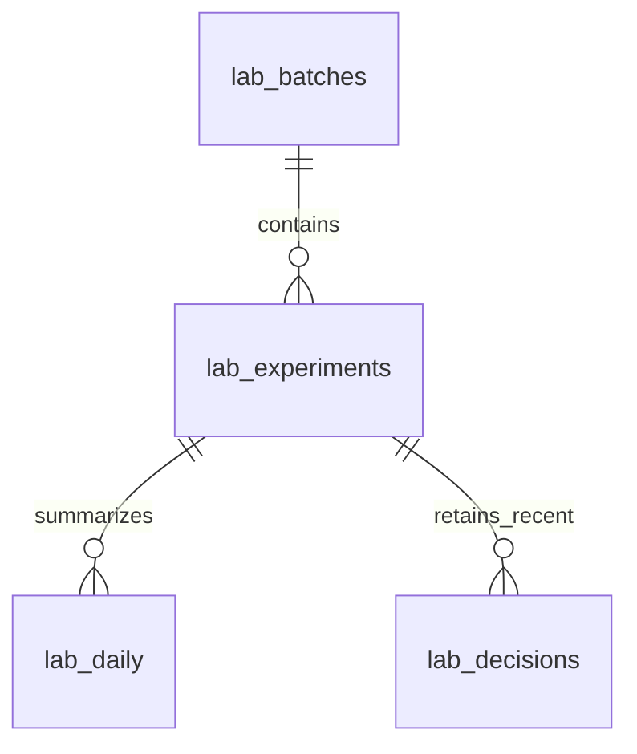

# 月度成绩与本金压力测算

2026-11-26：用户要求识别月度盈利稳定性、盈亏波动及估算本金分配。沿用现有管理员权限及独立实验账本。

## 数据与接口

不迁移数据结构、不写历史成绩。`lab_batches`（运行范围、状态、游标）一对多`lab_experiments`（累计逐笔成绩），每个实验一对多`lab_daily`（北京时间日期、结算数、投注整数分、净利整数分）。日汇总长期保留，不受30天逐期明细清理影响。

扩展现有GET `/api/platform/rule-lab/batches/{batch}/experiments/{experiment}`响应，新增`monthly`对象：rows（自然月、范围状态、结算数、投注额、净利、ROI、投注/盈亏日、最差日、按日终曲线的月内回撤）、summary（完整且有结算的月份数、盈利/亏损/持平月、最好/最差月、最长连续亏损月）、capital（原注额、整个已处理区间逐笔最大回撤、累计净利、样本与运行状态）。无新路由、无POST、无生产迁移。旧字段保持兼容。

| 响应字段 | 类型及口径 |
| --- | --- |
| rows[].month / range_start / range_end | YYYY-MM及配置范围内的首末日期 |
| rows[].status | complete/no_samples/partial/not_replayed/not_observed/pending |
| rows[].complete_month / eligible | 月份覆盖；覆盖且结算数大于0才eligible |
| rows[].settled_count / hit_count / refund_count / miss_count | 当月汇总非负整数 |
| rows[].stake_total / net_profit | 整数分汇总后转资金单位，净利可负 |
| rows[].roi_percent | 月净利÷月累计投注×100，零投注null |
| rows[].daily_close_drawdown / worst_day_profit | 月内日终最大回撤/最差投注日；无结算null |
| summary.* | 仅在展示范围内的eligible月份计算；无样本比例和极值为null |
| capital.* | 原固定注额与累计逐笔统计；available要求结算数及最大回撤均大于0 |
| window / observed_through / input_warnings | 展示范围、最近观察时间、跳过及冲突提示 |

权限沿用session cookie，管理员且拥有批次和实验才返回200；匿名401，非管理员403，其他所有者/不存在404，非法参数400，非GET405，账本繁忙503。保留现有JSON错误结构及no-store缓存策略。

最多输出最近120个自然月，读取指定实验在相同范围内最多3720条日汇总，明确截断范围；不扫描逐笔账本或上游源库。用同一只读事务读取实验、日汇总及游标，防止并发worker造成统计错配。CSV由当前已授权详情数据在浏览器生成。

完整月表示配置起点不晚于月初，回放已越过该月末且共同截止涵盖全月；源缺口/修订仍单独提示，不能据此声称每期数据完整。首月中途开始、未结束月、尚未回放、零结算月不当作盈利月。统计月按实际结算的北京时间归属，与既有lab_daily一致。月内日终回撤从该月净利0开始计算，不冒充逐笔回撤；跨月最大回撤使用现有累计逐笔指标。

## 本金测算

每个条件/OK/风控版本独立测算，不把390个互斥版本加总。设已有逐笔最大回撤D、用户压力倍数m（默认2，可改1～10）、用户可承受本金回撤比例r（默认20%，可改1～100%），压力回撤=D×m，比例对应本金=D×m/r，向上取到分。它是回撤容忍度换算，不是最低可运行本金、未来损失上限或资金分配建议；未建模同时占用、真实费用、滑点、跨策略相关性。D=0或零结算不输出本金金额，标记缺少亏损证据。保持原固定每注金额和全部风控阈值，不能只改下注金额线性放大收益。用户本金输入仅算压力回撤占比，所有输入仅浏览器内有效。

## 页面

批次结果和比较行均提供“月度成绩”，打开该实验详情定位月表。显示每月净利柱状图（正负颜色与数值）、明细表、完整月盈亏摘要、样本提示及资金压力输入。支持月度CSV；已有详情、筛选、分页、自动刷新和访问权限保持。

## 验证

纯统计用例覆盖自然月、跨年/闰月、部分月/未回放/零样本、完整月盈亏占比、日终回撤、长期120月边界和金额精度。集成用例覆盖历史日汇总超过最近90条、清理逐笔后月表保持、所有者隔离、并发一致快照与累计口径。浏览器验证月表入口、对比行选择、本金公式/非法输入/零回撤、CSV、键盘和手机布局。现有lab回归必须通过；发布避免重启lab，核验运行游标持续增加。
