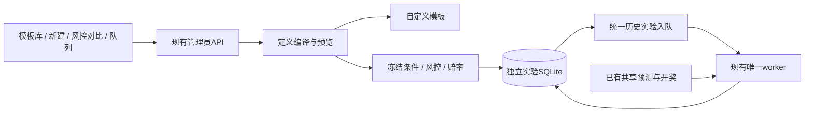

# 规则实验室自助配置：第一轮设计

状态：已按批准设计实现，验收通过，等待发布。设计基线 `8418233`，2026-11-28。
配套交互原型：`docs/RULE_LAB_SELF_SERVICE_DESIGN_20261128.html`。原型所有增删改仅作用于当前页面的演示数据。

## 1. 目标与范围

用户要自行维护条件、选择风控对照、批量创建实验并看到真实排队状态；不再依赖修改代码或后台清单。第一轮交付三个闭环：

1. 条件模板与独立风控模板的新建、复制、编辑、删除。
2. 从一个已有批次选择条件、赔率和风险方案，创建全新的可比组。
3. 多来源、多玩法创建，数量预览、保存草稿/保存并排队、队列暂停/继续/移出。

本轮不加入跨来源收益排名、候选收藏、批量删除/改名/续算、任意脚本条件、AND/OR组合条件、资金约束模拟或新结算赔率。后续数据预检仅做创建必要的来源资格及区间提示，完整缺失率仪表盘另做。

2026-11-28 已有 54 批次、1806 实验版本；容量为 80 批次/用户、2000 保存版本/全服务、100 运行版本/全服务。仅余 194 个版本，应在新建和比较预览里明确显示，不能为每次操作自动扩容。当前 jnd28 18 批次保留运行，名称已去日期；不因设计或模板编辑重建它们。

## 2. 核心决定

| 事项 | 决定 |
| --- | --- |
| 名称 | 默认“来源 · 玩法 · 模板名”，日期独立显示；模板改名不联动已有批次名称 |
| 条件 | 同一模板中的多条条件是独立实验，绝不暗示 AND/OR；每个条件内部只有一种现有判断 |
| 历史 | 实验使用创建时冻结的条件、风控、赔率；读取/续算不重新加载模板 |
| 默认风控 | 维持用户当前已接受的25%/20单基准，50%作为可选参数，不静默替换 |
| 预设出处 | 条件模板、风控模板、真实规则风控三类来源分别标注；实验风控模板独立于真实跟单方案 |
| 内置模板 | 只读，可复制为自定义；旧 basic_v1 仅历史可见，新建仍默认 basic_v2 |
| 删除模板 | 从可选库删除自定义模板，保留已有实验；不级联删批次、成绩、队列 |
| 入队 | 保存草稿与保存并加入队列是两个明确动作；普通历史批次的“启动”统一进入队列 |
| 续算 | 不在新建/入队时隐式开启定时续算；继续复用已有单对象续算页面 |
| 风控对比 | 原风控基准固定选中，只创建被选中的条件×赔率×去重后方案；结果从零重算 |
| 修改运行中实验 | 名称可改；参数必须复制新版本；正在排队的未启动批次编辑后退出队列 |

## 3. 页面交互

### 3.1 信息结构

保留现有“实验结果 / 风控对比”和“概览 / 月度 / 风险”结果结构。页头新增“模板库”和“运行队列”，与“新建实验”“系统”同级。结果区不同时展示模板编辑器、创建表单与队列大表。

模板库用一个抽屉，内有“条件模板 / 风控模板”切换；编辑使用该抽屉内的列表/编辑页切换，避免叠多层弹窗。新建实验也沿用抽屉，手机全宽；预览占下一步而非嵌套弹窗。主操作至少44px，键盘顺序跟随视觉顺序，Esc关闭并恢复入口焦点；未保存草稿离开前给出保存/放弃选择。反馈以内联为主，删除自定义模板才二次确认。

### 3.2 条件模板

列表字段：名称、适用玩法、条件数、版本、内置/自定义。搜索名称，按玩法筛选。每项可“查看 / 复制”；自定义另可“编辑 / 删除”。空列表给“从内置模板复制”与“新建”入口。

自定义模板适用一种玩法。创建多玩法批次时，为每种玩法分别选模板。复制内置综合包时选择玩法，展开成该玩法的实际条件。

编辑器包括：名称（1～60字符）、玩法、说明（可选，最多300字符）、条件列表。条件行包含启用选择、类型、方向（如需要）、比较符、阈值和窗口（如需要）。支持一次输入一组连续阈值，预览时展开成独立行；保存的是规范化后的原子条件，不保存可执行表达式。

第一轮支持当前引擎的六种条件：无条件、预测连错、预测连中、连续开出、连续不出、近N期预测方向命中率。阈值1～100期（引擎最长100期历史）；窗口限20/50/100；窗口命中率0～100%，最多两位小数；比较符≥/≤。数值0、负数、超范围、空方向、不支持玩法必须就地提示。命中率条件使用“预测方向命中率”，风控熔断使用“实赔/(实赔+全亏)”：两者在页面上不得同名误导。

无条件基准为第一项、固定保留；最多50个去重后条件（双赔率每批≤100版本）。大小/单双的“连续不出”按照已有逻辑规范化为相反方向“连续开出”，同义项只算一条。去重按语义字段，排除显示名称、顺序和模板版本；沿用现有 condition_key 计算，保证旧条件身份可对齐。

新建实验时可取消模板中的部分非基准条件，作为本次批次选择，不改变模板。修改模板显示实际增删与数量变化，不重算引用它的已存在实验。

### 3.3 风控模板与对照

风控模板编辑复用现有风控字段：按轮止盈/止损/最大注数、日止盈/止损/注数/开轮数、实赔命中率熔断阈值与最少有效单数、开轮间隔、最多一套附加日保护。保留 normalize_risk_policy 的金额精度、开启退出条件、开关语义校验。模板有适用玩法集合，默认选当前玩法；跨玩法复用须在新建预览里明示参数，不能自动替换25/50%。

可从当前实验风控保存为模板；也可复制真实规则快照，保存后成为独立模板，原规则更新不联动。模拟模板 provenance 由服务端产生，不把自定义模板ID冒充 rule_id/route_id。

“比较风控”入口从当前批次或选中结果进入。先选要比较的条件（默认当前行、否则要求明确选择），再选赔率（网盘/高赔可单选或双选），再选方案。基准只读锁定。快捷项为现有提前止盈、提前止损、降低日止损、关闭熔断；新增阈值/样本数组及自定义风控模板。

参数列表展示每项与基准的差异。输入25/20与基准相同则显示“与基准相同，不重复生成”；金额减半后无变化/不启用日层等显示具体原因。对照只保留完整有效政策，最多12个互异方案含基准。阈值快捷项修改所有启用的日风控层，必须展示附加层变化，不让隐藏层抵消对照；完全关闭的日层不自动开启。复杂多因素模板可选，但标注“多项变化”，不称为单因素试验。

选定条件与赔率从所属源批次的冻结实验获取，不能使用客户端上传的赔率或最新目录替换。源批次仅有单套赔率时只提供实际存在的选项。兼容现有两套赔率完整批次，不再要求任何比较源都必须含双赔率。相同来源、区间、条件、赔率的每个对照都新建；完成且实际输入证据相同才能展示相对差异。

### 3.4 批量新建

步骤一：选择来源（可搜索，最多20个）、玩法（最多3种）、历史回测/前向模拟、起止日期（回测）和模拟注额。
步骤二：按玩法选择条件模板与勾选条件，选择风控模板或手动配置；两套当前OK赔率按现有方式冻结。第一轮批量普通实验仍生成双赔率，单赔率选择仅用于风控对比。
步骤三：显示逐行清单：来源、玩法、稳定名称、条件数、版本数、日期、所用模板版本、风控摘要。支持改名称；不把日期写进名称。展示“将创建X批次/Y版本；创建后总量/额度；排队运行最多100版本”。相同语义组合出现两次自动合并并提示。

底部“保存草稿”与“保存并加入队列”。无有效条件、超容量、无来源权限、模板已删/版本过期均禁止创建并保留表单。任何组合失败，整个创建事务零新增；禁止静默跳过某些来源只建半套。

当前来源日期不足不自动伪造样本；建议共同可用日期，需用户采纳。第一轮不承诺完整来源质量审计；运行时保留已有迟到、缺失、冲突检查及跳过数。外部历史来源不需要建立真实跟单订阅。

### 3.5 队列

队列页包含“进行中 / 已完成”，支持来源和玩法筛选；列为批次/比较组名称、状态、顺序或当前子方案、实际已处理期数、操作。只显示真实进度；无法可靠估算时不输出剩余分钟。

状态语义：草稿（未入队）、等待运行（有有效队列条目）、运行中、手动暂停、需要处理（异常或输入不可用）、已完成。移出队列保留实验与成绩，可重新加入；它不同于删除实验。等待时显示原因，如“需要92个运行名额，当前空余50个”。排队不是已暂停，不能靠前端猜测。

允许等待项暂停/移出，运行项暂停，暂停项继续（重新入队），异常项修复后重试，已完成项查看结果。重新加入排队的已启动批次从原游标续跑，绝不清零。比较组整体控制、子方案仍不能独立启动。第一轮不提供拖拽优先级；使用公平队列，避免同时引入手动优先级规则。

## 4. 架构与数据契约

沿用 Python WSGI + 原生JS/CSS + SQLite 独立模拟库 + 现有唯一实验worker。无需引入新Web框架、任务服务或缓存。表现层解析权限/参数；service展开/验证；domain提供纯条件及风险编译；store负责唯一事务；worker调度/计算。

### 4.1 schema 7 加法迁移

| 表/列 | 用途与约束 |
| --- | --- |
| lab_templates | id、user_id、kind(condition/risk)、name、metric或metrics_json、definition_json、revision、deleted_at、created_at、updated_at；仅当前定义，历史实验已自带快照 |
| lab_command_receipts | user_id+request_id唯一；action、payload_hash、result_json、created_at；用于模板创建、批量创建、比较创建及队列命令；同ID异载荷409 |
| lab_queue_items | id、user_id、owner_kind(batch/study)、owner_id、state、queue_order、configuration_hash、revision、origin、created_at、updated_at；owner_kind+owner_id唯一，单对象只一个队列归属 |
| lab_batches.template_snapshot_json | 默认{}；冻结模板类型、原ID/内置key、名称、版本、所选condition_key。实际运行条件仍以 lab_experiments.condition_json 为准 |
| lab_batches.risk_template_snapshot_json | 默认{}；冻结出处/名称/版本，实际政策仍用 risk_policy_json |
| lab_batches.creation_request_id | 可空；同次批量创建归属，用于查看这一批提交的成员；不是运行调度主键 |

内置模板继续由现有代码产生，不批量重写旧批次。自定义模板同账号同kind+name的活动项不重名，复制默认“名称（副本）”并自动递增。软删除后不可新引用，读取历史实验只靠快照。模板容量每用户每类100个活动项，条件最多50条；单定义不超过32KiB。与实验容量独立。

所有新ID从非回收水位分配。初始化幂等，不扫描/重算所有历史成绩。旧批次快照列为空仍能读取、继续、导出；自选比较的续算完整性按该组实际冻结的条件/赔率集合检查，不再用全局“双赔率必齐”推断缺失；现有configuration_hash算法不加入展示名称/模板revision/provenance元信息，保留原冻结condition/risk/settlement字段参与哈希，确保改名不打断现有队列或续算。

### 4.2 条件与冻结

提取 `normalize_condition`、`compile_template`、`build_experiments_from_conditions`，built-in生成器调用同一规范化函数。存储语义字段为type/metric/operator/threshold/window_size/bet_value；服务端生成name/key。模板无跨实验共享运行状态。

新 payload 推荐使用 `condition_selection: {template_ref, expected_revision, condition_keys}`；自定义ref `{kind:'custom',id:12}`，内置ref `{kind:'builtin',key:'basic_v2',metric:'odd_even'}`。condition_keys必须属于该快照；模板在预览后被修改/删除则拒绝创建并要求刷新。引用源批次冻结条件时使用 `{kind:'batch_snapshot',batch_id:60,condition_keys:[...]}`，服务端验证归属，允许源模板已经删除。

原 `template_pack` 字段保留。新自定义批次为 `custom_v1` 并记录快照；所有依赖 build_experiments(template_pack) 的创建、编辑、复制入口统一通过定义解析器。普通复制默认使用原冻结条件，只有显式选择新模板时加载该模板当前版本；更换玩法必须重选匹配模板。continuation/read/export不能调用模板解析器重新生成定义。

### 4.3 API草案

前缀 `/api/platform/rule-lab`，沿用当前会话管理员鉴权及user_id隔离，匿名401、普通用户403、非本人对象404。请求字段白名单及有限JSON大小继续执行。

| 方法/路径 | 请求要点 | 结果 |
| --- | --- | --- |
| GET /templates?kind=condition&metric=odd_even | 允许的筛选组合 | 内置及本人活动模板摘要 |
| GET /templates/{id} | 本人自定义 | 完整定义、revision |
| POST /templates | request_id,kind,name,definition | 201/幂等200 |
| POST /templates/{id}/edit | request_id,expected_revision,name,definition | revision+1，原实验保持 |
| POST /templates/{id}/delete | request_id,expected_revision | 软删除，不删实验；重复删除可幂等返回 |
| POST /templates/preview | kind,metric,definition | 去重条件、校验消息、版本数量；只读 |
| POST /batches/preview | sources,metric_configs,range,stake,name_pattern | 只读规范化清单、preview_revision、容量与阻断原因 |
| POST /batches/bulk | 同配置+request_id,preview_revision,enqueue | 一个事务创建所有实验/快照/收据/可选队列 |
| POST /studies/preview | source_batch_id,condition_keys,settlement_rule_ids,candidates | 基准及差异、去重后的政策、清单、preview_revision |
| POST /studies | 旧载荷保持；新载荷增加上述选择与preview_revision | 新建比较组及冻结子批次；enqueue可选 |
| GET /queue | state筛选，返回本人对象和全服务名额汇总 | 条目、运行/等待原因、revision |
| POST /queue/enqueue | request_id,owner_kind,owner_id,expected_revision | 新建/重新排队，不重复同对象 |
| POST /queue/{id}/state | request_id,expected_revision,action(pause/resume/remove/retry) | 条目和对象状态原子更新 |

模板复制使用GET旧模板→POST新模板，不增加第二套copy存储流程。预览只读，preview_revision是规范化定义与模板版本/源批次冻结定义的指纹；不是资源预留。提交先检查幂等收据，再重查权限、版本、定义、容量；源库资格在入事务前作有限读取，实际历史可用性仍由worker检查，不能宣称两库原子快照。跨来源未取得同一输入证据不显示可比排名。

模板/批量预览与创建接口上限128KiB；其余旧路由仍16KiB。来源≤20、玩法≤3、展开批次≤60，条件≤50/玩法，比较政策≤12。API需按新增路由定向调整现有严格query参数/16KB逻辑，不全局放宽。

## 5. 调度与迁移

### 5.1 调度权威

新普通历史批次与现有比较组的入队统一交给 `rule_lab_queue`，仍由现有worker在tick内驱动；不再由另一个无限运行脚本定期自动启动同一批次。已有live和连续series保留原算法/入口，运行名额在同一个SQLite事务下核对。

队列条目与lab_batches/lab_studies状态在同一事务更新。draft没有有效条目；queued条目的批次底层可保持paused，公开新增queue_state/display_status准确显示等待。读接口只依赖数据库，不读任意manifest路径，不在浏览器读取host文件。

全局历史顺序取一个单调序号；比较组一个子批次完成后排到队尾，普通批次完成即释放。启动时重读owner状态、删除/退出标记、配置指纹和实际运行数。跨API、旧兼容入口、续算、重复tick均必须经过容量检查。排首项暂放不下则明确等待，不用小批次无限插队；不抢占正在运行任务。

单tick只处理有限队列条目（≤20）及一次有限晋级预算（≤100ms，测试校准）；当前工作预算/内存/存储限制不变。`list_work_batches`应按全服务运行名额上限调整读取上限，避免现有LIMIT 50掩盖超过50个小批次，并保持轮转；旧pending需要独立有界处理，不能挤掉所有运行项。

状态：queued→running→completed；queued/running→paused；paused→queued；queued/paused→removed；运行项移出时先暂停并保留当前状态；error/resource_paused需明确retry才能重新queued。修改未启动配置退出队列；纯改名不退出。删除将队列条目同步移出，管理清理job再分页删除成绩。旧API `/state`必须同步维护队列，防止从旁路暂停后被再次自动启动。

### 5.2 当前 jnd28 清单接续

实施时先读取白名单清单 `jnd28-trials-20261128.json` 和数据库核对18个ID/归属/配置指纹。仅停止这份清单的启动进程（不暂停实验worker、也不停止运行批次），取最终清单，导入新队列：

- 已完成→completed；运行中→running（保留游标、统计和pending）；未启动且清单有效待启动→queued；人为暂停→paused；removed/配置已变/已删→removed。
- `enable_continuation:false` 保持；导入不建立series、不开启任何每日任务。
- 导入以manifest摘要和owner唯一键幂等；二次导入不重复。新worker确认数据库调度权威后，旧清单进程不再启动。
- 旧的 `machine-trials-20261127.json` 已退出且有原续算计划，不导入它来重复配置schedule。
- 回退不覆盖实验库或清零成绩；暂停新调度后可按当前队列导出一次性清单，仅恢复未被用户暂停/移出的项，或前向修复。

schema升级时若需要切换worker版本，只按已有发布流程在tick边界短暂重启，保留SQLite事务和全部已保存进度；设计阶段不执行迁移或停服务。

## 6. 失败与反馈

- 保存时按钮显示提交中并禁重复；网络丢响应保留request_id，用同请求查回执，不能重新编号造成重复批次。
- 版本冲突：保留草稿，显示“模板已更新，请重新预览”；不自动覆盖别人修改。
- 容量不足：显示缺少多少版本/批次数；不自动删旧实验、不默默减选、不自动提高上限。
- 加载失败：保留上次结果并显示更新时间；不能把旧列表标作新提交成功。
- 模板删除：具体说明已有实验继续使用快照；不列删除成绩的误导文案。
- 暂停/继续失败：重新读取状态，保留用户原意；不用HTTP未知状态假装成功。
- 异常输入：显示来源/日期/处理办法；不输出凭证、SQL栈或服务文件路径。

## 7. 文件划分与落地顺序

| 模块 | 主要文件 | 验收结果 |
| --- | --- | --- |
| A 模板与冻结 | 新domain/rule_lab_templates.py、services/rule_lab_templates.py；store/schema/service/API适配 | 可维护模板，旧快照和续算哈希不变 |
| B 自选比较 | domain/rule_lab_comparison.py、store/create_study、service/API | 选1条件×1赔率×2方案只建2个版本，基准去重且输入可比 |
| C 批量与队列 | 新services/rule_lab_queue.py；worker/management/series接入；有限清单导入CLI | 18批次一键预览创建，暂停/移出不被自动重启，资源额度正确 |
| D 页面 | 现有rule_lab.html/css/js，新增rule_lab_templates.js、rule_lab_queue.js负责各抽屉 | 手机/桌面、草稿保留、状态可理解，结果页结构保持 |
| E 发布验证 | 临时库与生产一致副本、幂等迁移、队列切换记录 | 不重算/删除原1806版本，不修改真实跟单方案 |

先A后B，再C和页面联通；不先上线“模板可编辑”却让fork/continue从当前模板重建。每阶段有可运行入口和测试，但最终按三个闭环一起交付，避免只做按钮。

## 8. 必须通过的验收

1. 建模前后内置basic_v1/v2/long_miss语义、condition_key、当前全部原成绩不变。
2. 模板改阈值/改名/删除后，已有实验条件、风险政策、赔率、配置哈希、累计/每日数据和后续同输入输出不变。
3. 同义条件去重；非法阈值/窗口/玩法、超50条件、未启用退出条件全部拒绝且没有部分写入。
4. 自选单赔率比较、单条件比较、附加日风控、baseline重复、重复候选、无可用对照都有明确结果。
5. 所有比较子方案保留选中源实验的实际冻结赔率；不能无意升级到新目录；最后实际输入不一致时仍拒绝差值。
6. 批量创建最后一项失败、并发抢容量、重复request_id、同ID异内容、丢响应重试，全组只有零或一份。
7. 原2000/80/100限制、运行名额在普通/比较/live/series并发调用下正确；队列无法绕过。
8. 正在运行时暂停、等待时移出、后台刚选中后删除/编辑，以及旧/state旁路操作，都不能被旧快照重新启动。
9. 清单运行中迁移、重复导入、旧脚本未退出、故障回退演练；ID/游标/资金/日账保持，只有一个启动者。
10. 新批次名字无日期；改名仍队列可用；实际覆盖日期随已有续算结果展示。没有用户显式操作时series数量不增加。
11. 模板、批量、比较、队列所有路由的跨用户访问、字段注入、超大载荷、HTML文本输入和存储失败测试。
12. 临时真实API+DOM交互覆盖模板CRUD、数量变化、过期预览、保存/入队区别、队列状态、抽屉键盘和手机窄屏。浏览器可用时另验布局；DOM测试不冒称像素验收。

## 9. 设计取舍

不把模板系统扩大为脚本策略平台：当前六种条件已能满足自助阈值调整，且保持有界历史窗口。第一轮限制50条件而不自动拆分，是为了避免无意爆炸出大量批次；用户可拆成多个有名称的模板。当前“预测命中率入场条件”和“实赔命中率熔断”必须分开标注，这是比再加更多参数更直接的可理解性改进。

本设计仅冻结方案；不声称用户已启用新的续算计划、模板或队列行为。

## 10. 原型验证记录

2026-11-28：HTML内嵌JavaScript语法检查通过；在jsdom运行真实原型脚本，验证内置模板只读、自定义复制/保存/删除、同义参数去重、风控模板保存、选择方案2→3版本变化、批量数量与容量阻断、名称不含日期、排队项暂停/移出，0脚本错误、0网络请求。此为原型DOM功能验证，没有启动浏览器或测量真实像素布局。

原型使用演示数据，首次1806/2000为设计时容量示例，不是实时查询。高级风控字段和发布迁移以本文完整契约为准；原型不承诺后台已实现。生产实验继续由现有worker和一次性清单运行。
