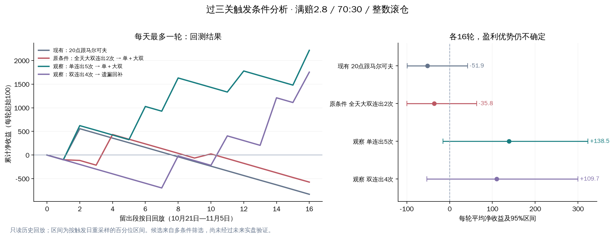

# 过三关实盘与自动触发条件分析

数据快照：2026-11-05 22:08:45 北京时间。开奖截止当日 22:07:00，现存明细覆盖 2026-09-06 至 2026-11-05。此目录是研究产物，没有更改线上规则、投注金额或服务。

**结论：找到几组历史表现比现有定时条件更好的观察候选，但没有证据确认任何一组已具备稳定的正收益。最值得优先影子观察的是“实际连续开单≥5期 → 固定单＋大双，全天等待、每天最多一轮”。当前满赔2.8规则本身的过三关率就很低，不能用另一套网盘赔率的约40%过关率作预期。**

## 1. 这两天实际发生了什么

按正常周期、真实送达、已结算两腿还原，仅有 3 轮有效过关，22 笔/11 期；每笔金额均与当前结算引擎重算一致。

| 方案 / 首期北京时间 | 起始金额 | 投注期数 | 盈利期数 | 最高连续盈利 | 最终净收益 | 剩余账户尾差 |
|---|---:|---:|---:|---:|---:|---:|
| 马尔可夫，11-04 20:39:30 开奖期 | 100 | 3 | 2 | 2 | -98.80 | 1.20 |
| 固定单＋大双，11-05 00:02:30 开奖期 | 10 | 7 | 4 | 2 | -7.65 | 2.35 |
| 马尔可夫，11-05 20:04:30 开奖期 | 100 | 1 | 0 | 0 | -100.00 | 0 |
| 合计 | 210 | 11 | 6 | — | **-206.45** | 3.55 |

逐期盈利率为 **6/11 = 54.55%**，过三关率为 **0/3**。这两个指标含义不同；样本不足以据此判断预测器突然失效。

第一轮先净赚 98.80，再净赚 209.40，第三期投入 407 全亏，最终只剩 1.20 尾差。第二轮中，两次中奖分别遇到对子和 13，中奖腿只退本金，另一腿亏损，净利为负，所以关数归零。`chain` 模式滚的是返还额，未投出的零头留账户；剩余账户尾差不表示本轮仍有可滚动注码。

必须另外保留的资金事实：早期还有 **166 笔作废事件**，其中 **165 笔有真实送达回执且因旧周期缺陷被作废**，另 1 笔未送达。这批旧周期不符合现行三关流程，因此不能并入正常过关胜率。记录中的投注额合计 8,300、保存净收益合计 +4,446.60 只是旧账面字段，**未与群账独立核对，不能当作已确认实盘利润，也不能因状态为 void 就视作未下注**。因此 -206.45 是 3 轮正常过关的净收益，不是两天账户所有真实流水的完整损益。

原始的规则名称也不是历史配置快照：规则9的 11-04 正常轮实际在 20:37:26 才启动，不能把它当成标准20:01回放；规则11在提取时已改为 08:03–08:30 的条件加定时模式。以下将历史触发和当前配置分开列出。

## 2. 为什么“覆盖三个组合”仍很难过三关

当前两个过关方案使用 **彩28满赔2.8**：单双 2.84；小单/大双 6.79；大单/小双 6.33。中奖遇 13/14、对子、顺子（含首尾顺）或豹子退本金。两条腿不会同时中奖：

- `单70 大双30` 中，如果“单”中奖但只退本70，整期仍亏30，关数清零。
- 如果“大双”中奖但只退本30，整期亏70，关数清零。
- 两腿都不中则本期注码全部损失。

枚举 1,000 种独立均匀三球结果，使用生产结算函数：

| 结构 | 整期真正盈利 | 命中但仅部分退本、整期亏损 | 两腿全亏 | 每投入100的单期期望净利 |
|---|---:|---:|---:|---:|
| A 单＋小双 / D 双＋大单 | 41.4% | 31.7% | 26.9% | -0.2684 |
| B 单＋大双 / C 双＋小单 | 39.6% | 37.3% | 23.1% | -0.2678 |

按相同独立均匀假设，每种结构模拟 300,000 轮，整数下注、初始100、70/30 chain滚仓，三关完成率约 **14.17%–14.73%**。三轮全部不过的概率约 **62%–63%**。这些是模型概率，不是预测命中率，也不证明未来数据一定独立均匀。

B结构的不同目标对照：

| 每轮目标 | 达到目标的概率 | 整轮最终盈利的概率 | 平均净收益 / 轮（模拟） |
|---|---:|---:|---:|
| 1关 | 62.94% | 49.33% | -0.40 |
| 2关 | 32.57% | 28.37% | -0.49 |
| 3关 | 14.73% | 13.71% | -0.81 |

降低目标会提高“过关率”，但不能自动创造正期望。尤其亏损后从较小注码连赢若干关，有可能已经达标、整轮仍未回本。模拟均值存在误差，详见 `iid_round_simulation.csv` 的标准误；不能把表中小幅均值差异当作不同目标的显著收益差异。

此前上游 `reports/pc28_split_roll/report.md` 的约39%–45%通过率采用 **满赔网盘1.99/3.71/4.32**，仅0/27影响命中主注，退款规则不同，而且未做当前整数下注。该结论不能直接套到本次实盘的满赔2.8。

## 3. 如何避免选出“碰巧漂亮”的条件

- 24,490 期完整三球开奖，期号连续，无缺期；253,667 条原始预测，240,391 条通过状态和时间检查。463 条晚于开奖前40秒的预测排除，其余12,813条为未结算/失败/过期等状态。时间按上游创建和结算记录核查。
- 按时间预先划分：09-06–09-30训练，10-01–10-20验证，10-21–11-05留出检验。最后一段不用于筛阈值。由于这是回顾性研究且仓库已有历史报告，不将该时间切分冒充真正前瞻试验。
- 21种结构/来源流 × 91种条件，共 **1,911 个候选**。包括实际连开、预测连错、20/50/100期高低命中、定时，以及无条件对照。旧预测的命中只在其结算时间到达后进入特征；实际连开只看决策前已公布开奖。
- 初始统一100，70/30、整数下注、chain、3关；同一候选一次只运行一轮，主比较每天最多1轮。触发后持有同一策略到过关或本轮注码不足2，跨日不人为截断，轮终结当天之外可再按新日额度等待条件。
- 每段至少15轮，训练/验证收益都为正，按二者较低的每轮收益排序选前5。89组通过初筛。即便如此，在大量候选中仍可能挑中偶然结果，故进一步检验增加触发次数、入场延迟和相邻阈值。
- 回放采用每期“开奖前40秒”作为统一可下注决策截止；期内早先的瞬时条件或未保存的历史预测版本无法完整还原。定时窗口按该决策时刻判断，来源发布/请求延迟可能令真实入场错开一期。另有1–2期延迟敏感性结果。
- 使用当前保存的预测值；数据库并非不可变更的预测版本档案。只模拟理论可用信号，不包含群组拒单、限额、停服、手续费、资金总额不足或所有实际送达延迟。每轮补足初始金额，累计收益不是只凭100本金即可实现的资金曲线。

## 4. 现有条件与候选条件的同口径比较

下表全部为**每天最多1轮、每轮100、当前满赔2.8规则**；“后段过关”使用 10-21–11-05，均16轮。前两列利润只用于预选，后段只检验。

| 条件及结构 | 训练净利 | 验证净利 | 后段过关 | 后段净利 | 后段最大回撤 |
|---|---:|---:|---:|---:|---:|
| 原定时：20:01，逐期跟随马尔可夫 | -929.13 | -795.25 | 1/16，6.25% | **-830.57** | 1,647.51 |
| 原条件：全天大双连续≥2，固定单＋大双，波动反弹提供信号 | -990.44¹ | -308.83 | 3/16，18.75% | **-573.04** | 1,215.90 |
| 观察：马尔可夫近20期单双命中≤35%，固定单＋小双 | +2,589.56 | +2,857.27 | 3/16，18.75% | +798.78 | 772.78 |
| 观察：实际双连续≥4，逐期跟随遗漏回补 | +2,453.95 | +2,988.67 | 4/16，25.00% | +1,754.65 | 795.71 |
| 观察：实际大单连续≥1，固定双＋大单，马尔可夫提供信号 | +2,195.38 | +2,095.41 | 5/16，31.25% | +2,395.66 | 597.20 |
| 观察：实际大双连续≥3，逐期跟随频次趋势 | +1,979.78 | +2,017.32 | 4/16，25.00%² | +685.04 | 499.48 |
| **优先观察：实际单连续≥5，固定单＋大双，马尔可夫提供信号** | **+2,172.14** | **+1,637.72** | **5/16，31.25%** | **+2,216.44** | **345.05** |

¹ 波动反弹上线较晚，训练仅12轮；不参与“至少15轮”的候选预选，作为现有条件保留。其他完整日候选的训练为25轮、验证为20轮；频次趋势大双≥3在训练段为24轮。

² 频次趋势该条件4轮达到三关，但只有3轮最终盈利。这正是“过关”不等于“整轮回本”的实例。

旧“马尔可夫预测单双连错5次”条件：训练25轮 -490.16、验证20轮 +849.51、后段16轮 +1,645.01，未通过两段都正的筛选；它不能仅凭最近一次正收益被称为更稳。

提取时**当前规则11已是“08:03–08:30＋大双连出≥2”**。这个组合在训练/验证/后段分别只有4/8/3轮，净利 +403.05/+138.52/-298.23；后段0/3过关。前表原条件的全天16轮不能冒充现在这一时间窗口的表现。该行同样统一用100起注，当前方案实际10起注不可简单除以10，因为整数拆注会改变轨迹。



## 5. 为什么目前只能推荐观察

“单连续≥5 → 固定单＋大双”在最后16轮中有5轮成功，过关率95% Wilson区间约 **14.16%–55.60%**，仍很宽；每轮净收益的按触发日bootstrap区间约 **-15.30 至 +323.35**，包含亏损。

该条件与原20点方案在相同16天的配对优势，单侧符号翻转近似检验 p≈0.0287；对这5个入围方案作Holm校正后 **p≈0.1437**，未达到0.05。这只校正5个留出比较，依赖按日差值可交换假设，不是对整套历史研究和全部选择行为的严格全局显著性证明。

扩大触发频次到“全天重复，冷却10期、轮次不重叠”，同一后段结果：

| 入围条件 | 完整轮数 | 过关率 | 净收益 |
|---|---:|---:|---:|
| 马尔可夫20期低命中→固定A | 160 | 12.50% | -1,418.21 |
| 双连开4→遗漏回补 | 171 | 13.45% | -1,884.61 |
| 大单连开1→固定D | 473 | 13.74% | -8,142.40 |
| 大双连开3→频次趋势 | 81 | 13.58% | -1,554.65 |
| **单连开5→固定B** | **100** | **14.00%** | **+688.31** |

前4个候选对“每天首次触发”的抽样方式敏感，不具备泛化证据。最后一个也仅小幅正收益：频次回放每轮平均收益的按日分块区间为 **-41.77 至 +68.44**，不排除没有优势。

入场敏感性更明显：优先候选在后段按时入场 +2,216.44，迟一期仅 +24.72，迟两期 -1,588.60，16轮全不过。相邻阈值“单连开4”在训练段亏损。故不能把“单连续5”解释成已经证明的开奖规律，也不能在错过后追入。

## 6. 我会怎样安排下一步

先固定一组条件做**影子观察**，记录从现在起的新结果，避免每天根据刚发生的输赢更换阈值：

| 配置项 | 观察方案 |
|---|---|
| 来源 | 组合马尔可夫 V1，预测器8；仅提供可投期号/信号 |
| 结构 | **B：主注单70%、辅助大双30%**，不随来源组合切换 |
| 触发类型 | 实际“连续开出”→单双→单→≥5期；并非预测连错5次 |
| 开始时间 | 全天等待当日首次满足条件；先不附加20点或08点窄窗口 |
| 触发后玩法 / 路由投注 | 保持原玩法 / 继承跟单方案 |
| 目标 / 滚动 | 3关 / chain / 整数注码 |
| 轮次 | 每天最多1轮，达标和本轮资金耗尽都当天收工 |
| 入场 | 当期仍符合封盘窗口才记入；错过记录为未执行，不在下期追单 |
| 观察金额 | 主报告统一100；若模拟10，须用10的实际整数拆注，不能按比例缩小收益 |

10起注的优先候选，后段16轮为5轮过关、净利 +204.12、最大回撤32.48，仅属历史模拟。100起注对应的最大回撤345.05已说明，需要多轮资金储备，不能把“每轮100”和“总本金100”混为一谈。

至少新增50个完整观察轮后再做预先约定的复核，并保留原定时策略的同期影子对照；50轮只是第一次复核门槛，不代表统计上已经足够。考核净利润、达标但亏损的轮数、最大回撤和错过窗口比例，而不仅看过关率。没有证据支持现在直接提高起注或每日轮数。若更看重频繁过关，可以单独观察2关目标，但须接受较低单轮收益，且不能把提高成功率理解为提高长期期望。

本次没有把任何候选写入线上配置。

## 7. 复现与文件

- `extract.py`：只读提取字段，排除API密钥、会话和来源URL。原始快照保存在本机受限临时目录；`metadata.json` 留有摘要及SHA256。
- `analyze.py`：真实账务核对、生产结算函数生成的赔率表、1,911组按时间分段比较和固定筛选规则。
- `robustness.py`：独立均匀三球模拟、延迟/相邻阈值/频次敏感性、按日区间及配对比较。
- `actual_rounds.csv`、`actual_periods.csv`：正常实盘轮次与逐期账；`actual_audit.json` 单列作废事件问题。
- `candidate_results.csv`、`selected_candidates.csv`、`selected_rounds.csv`：完整筛选和入围结果。
- `sensitivity.csv`、`trigger_delay_sensitivity.csv`、`threshold_neighbors.csv`：金额、目标关数、频次及延迟对照。
- `holdout_comparison.png` / `.pdf`：可独立查看、导出的对比图。

命令（在pc28touzhu目录）：

```bash
python3 docs/roll_trigger_analysis_20261105/extract.py /tmp/pc28-roll-research-20261105/snapshot.json.gz
PYTHONPATH=src /www/wwwroot/AITradingSimulator/.venv/bin/python docs/roll_trigger_analysis_20261105/analyze.py /tmp/pc28-roll-research-20261105/snapshot.json.gz
PYTHONPATH=src /www/wwwroot/AITradingSimulator/.venv/bin/python docs/roll_trigger_analysis_20261105/robustness.py /tmp/pc28-roll-research-20261105/snapshot.json.gz
/www/wwwroot/AITradingSimulator/.venv/bin/python docs/roll_trigger_analysis_20261105/plot.py
PYTHONPATH=src:docs/roll_trigger_analysis_20261105 /www/wwwroot/AITradingSimulator/.venv/bin/python -m unittest discover -s docs/roll_trigger_analysis_20261105 -p test_analysis.py -v
```

重新提取会更新快照截止时间，不应把新数据产生的结果称为本报告同一实验。6项研究验证已通过：未来结算不能提前进入特征、未公布开奖不能触发、缺期中断连续计数、退款影响滚动及关数、每日限额/轮次不重叠、跨验证边界剔除。每个结构流还抽样约60个完整周期，与生产 `settle_period` 逐期比对，金额和停止原因一致。
